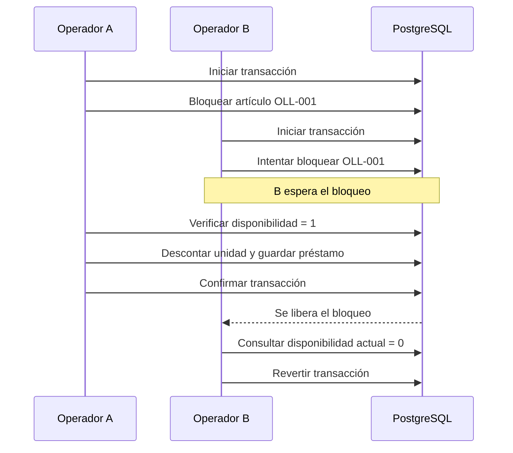

# ADR-002 — Control de concurrencia en préstamos

**Estado:** Aceptado  
**Fecha:** 2026-11-12  
**Proyecto:** Kitchenware  
**Decisión:** Utilizar transacciones y bloqueos de filas de PostgreSQL para garantizar que una unidad no pueda prestarse dos veces simultáneamente.

## 1. Contexto

Kitchenware administra artículos de menaje que pueden tener varias unidades disponibles.

Cuando se registra un préstamo, el sistema debe comprobar la disponibilidad de cada artículo, descontar una unidad y guardar el préstamo con sus líneas.

Existe un problema de concurrencia cuando dos usuarios intentan prestar la última unidad del mismo artículo al mismo tiempo.

Por ejemplo:

- El artículo `OLL-001` tiene una unidad disponible.
- El operador A intenta registrar un préstamo de `OLL-001`.
- El operador B intenta registrar otro préstamo del mismo artículo.
- Ambas solicitudes llegan casi simultáneamente.

Si las operaciones consultan y modifican el inventario sin coordinación, podrían registrar dos préstamos para una sola unidad.

Esto incumpliría la regla:

`0 <= available_units <= total_units`

También produciría una inconsistencia entre el inventario y los préstamos.

## 2. Decisión

Kitchenware utilizará **transacciones de PostgreSQL y bloqueos pesimistas de filas** para proteger el registro de préstamos y devoluciones.

La implementación se realizará en Laravel mediante su sistema de transacciones y consultas con bloqueo, como `lockForUpdate()`.

Se establecen las siguientes reglas:

1. Toda operación de préstamo se realizará dentro de una transacción.
2. Se bloqueará la fila del vecino para serializar los préstamos simultáneos de una misma persona.
3. Se comprobarán las líneas pendientes y vencidas del vecino dentro de la transacción.
4. Las filas de los artículos solicitados se bloquearán antes de comprobar su disponibilidad definitiva.
5. Los artículos se bloquearán en un orden estable, por identificador, para reducir el riesgo de interbloqueos.
6. Se validará que cada artículo tenga por lo menos una unidad disponible.
7. Se descontará una unidad por cada línea aceptada.
8. Se guardarán el préstamo y sus líneas dentro de la misma transacción.
9. Si alguna validación falla, se cancelará toda la operación.
10. Si no existe disponibilidad, la API responderá HTTP 409 con el código `ARTICLE_NOT_AVAILABLE`.

Las operaciones de devolución también utilizarán una transacción para impedir que una línea se devuelva dos veces y para actualizar correctamente las unidades disponibles.

Las reglas de negocio continuarán en el dominio y en los casos de uso. Los bloqueos y las transacciones serán responsabilidad del adaptador de persistencia y de la coordinación transaccional de la aplicación.

## 3. Flujo de préstamo concurrente

El proceso seguirá esta secuencia:

Resultado esperado:

| Solicitud | Resultado |
|---|---|
| Operador A | HTTP 201 — Préstamo registrado |
| Operador B | HTTP 409 — `ARTICLE_NOT_AVAILABLE` |

El orden de éxito puede invertirse. Lo importante es que únicamente una solicitud registre la última unidad.

## 4. Alternativas consideradas

### Alternativa A: Comprobar disponibilidad sin bloqueo

Se descartó porque dos solicitudes podrían leer la misma cantidad disponible antes de actualizarla.

### Alternativa B: Bloqueo optimista mediante versiones

Esta alternativa consiste en agregar o utilizar un testigo de versión y rechazar las actualizaciones cuando otro proceso haya modificado previamente el registro.

Es una solución válida y corresponde al enfoque planteado en el modelo técnico de referencia de Manager Library.

No se seleccionó para Kitchenware porque se decidió utilizar transacciones y bloqueos de filas de PostgreSQL para coordinar la lectura y actualización del inventario.

### Alternativa C: Bloqueo pesimista mediante PostgreSQL

Se seleccionó porque permite serializar las operaciones que compiten por la misma unidad y coordinar la creación del préstamo con el descuento del inventario.

## 5. Consecuencias

### Positivas

- Se evita prestar dos veces la última unidad.
- El inventario mantiene cantidades válidas.
- El préstamo y el descuento se guardan como una sola operación.
- Los errores no dejan cambios parciales.
- Se pueden proteger también los límites de préstamos por vecino.
- El comportamiento puede comprobarse mediante pruebas concurrentes.

### Negativas

- Una solicitud puede tener que esperar a que termine otra.
- Deben controlarse adecuadamente los tiempos de espera y los posibles interbloqueos.
- Es necesario definir un orden estable para adquirir bloqueos.
- Las pruebas de concurrencia requieren una base PostgreSQL real.
- Los errores técnicos de bloqueo o transacción deben tratarse sin exponer información interna.

## 6. Reglas de consistencia

Se deberán mantener las siguientes invariantes:

- `available_units` nunca será negativo.
- `available_units` nunca superará `total_units`.
- Un vecino no podrá tener más de tres artículos pendientes de devolución.
- Un vecino con artículos vencidos no podrá registrar nuevos préstamos.
- Cada línea de préstamo corresponderá a una unidad.
- La devolución aumentará la disponibilidad exactamente una vez.
- Un préstamo fallido no modificará el inventario ni creará líneas.
- Los datos históricos de las líneas permanecerán inalterados.

Estas reglas se comprobarán mediante el dominio, los casos de uso y las restricciones de base de datos que correspondan.

## 7. Verificación

La decisión se verificará mediante pruebas automatizadas contra PostgreSQL 16.

### Prueba 1. Última unidad

1. Crear un artículo con `total_units = 1` y `available_units = 1`.
2. Crear dos vecinos habilitados para recibir préstamos.
3. Ejecutar simultáneamente dos solicitudes de préstamo del mismo artículo.
4. Verificar que una solicitud sea exitosa.
5. Verificar que la otra reciba HTTP 409.
6. Comprobar que `available_units = 0`.
7. Comprobar que solo existe una línea de préstamo pendiente para esa unidad.

### Prueba 2. Límite concurrente por vecino

1. Crear un vecino con dos artículos pendientes.
2. Preparar dos préstamos simultáneos de artículos diferentes para ese vecino.
3. Verificar que solamente uno pueda completar la tercera línea pendiente.
4. Comprobar que el vecino no supere tres artículos sin devolver.

### Prueba 3. Devolución duplicada

1. Crear un préstamo con una línea sin devolver.
2. Ejecutar dos solicitudes de devolución simultáneas.
3. Verificar que la primera devolución válida se registre.
4. Verificar que la segunda responda HTTP 409.
5. Confirmar que la disponibilidad aumentó una sola unidad.

### Prueba 4. Atomicidad

1. Intentar prestar dos artículos.
2. Preparar uno con disponibilidad y otro sin unidades disponibles.
3. Confirmar que se rechace el préstamo completo.
4. Verificar que no se haya descontado ninguna unidad ni creado el préstamo.

## 8. Relación con el proyecto

Este ADR complementa los siguientes documentos:

- `docs/constitution.md`: invariantes y consistencia.
- `docs/spec.md`: reglas de préstamos y concurrencia.
- `docs/architecture.md`: flujo transaccional de préstamos.
- `docs/data-model.md`: restricciones e índices.
- `docs/api-contract.md`: respuestas HTTP 201 y 409.
- `docs/tasks.md`: tareas `T-09`, `T-10`, `T-13` y `T-16`.

La implementación principal de esta decisión corresponde a la tarea `T-13`.

**Este ADR registra la estrategia de concurrencia elegida para Kitchenware. Su funcionamiento deberá demostrarse mediante código ejecutable y pruebas automatizadas durante la sustentación individual.**
