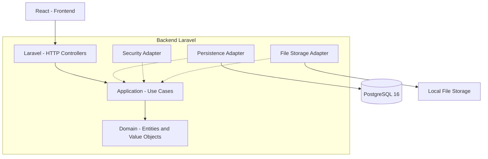
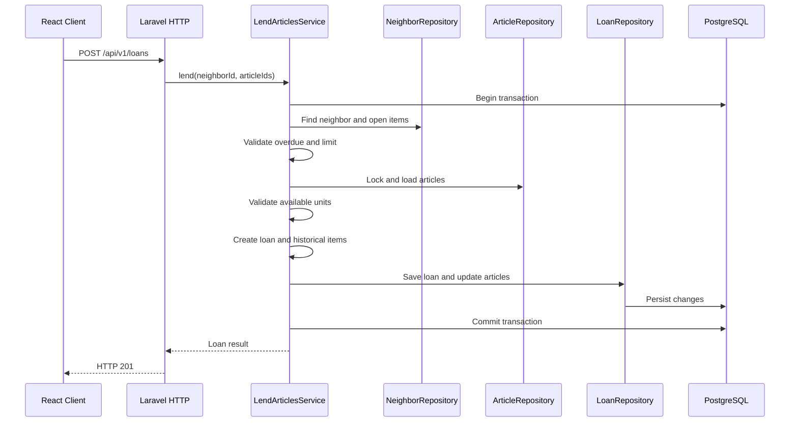

# Arquitectura — Kitchenware

**Proyecto:** Sistema de Préstamo de Menaje de un Salón Comunal  
**Identificador:** kitchenware  
**Ficha:** ADSO 3239137  
**Aprendiz:** A16  
**Tecnologías:** React, PHP, Laravel y PostgreSQL 16

## Propósito

Definir la arquitectura del sistema Kitchenware, sus componentes, responsabilidades, dependencias y mecanismos de comunicación.

El sistema implementará una arquitectura hexagonal basada en puertos y adaptadores, respetando los principios establecidos en `constitution.md` y las funcionalidades definidas en `spec.md`.

El modelo de persistencia se encuentra en `data-model.md`, el contrato HTTP en `api-contract.md` y las actividades de implementación en `tasks.md`.

---

## 1. Capas y dependencias

Kitchenware estará organizado en tres capas principales dentro del backend: dominio, aplicación e infraestructura.

El frontend React será un cliente independiente que consumirá la API HTTP de Laravel.

### 1.1. Capa de dominio

Contendrá las entidades, objetos de valor y reglas de negocio.

Entidades principales:

- `Article`: representa un artículo de menaje.
- `Loan`: representa un préstamo realizado a un vecino.
- `LoanItem`: representa una línea de préstamo.
- `Neighbor`: representa un vecino registrado.
- `User`: representa un administrador u operador.

Objetos de valor:

- `ArticleReference`: identifica la referencia de un artículo.
- `Quantity`: representa cantidades válidas.
- `DocumentNumber`: representa el documento de un vecino.
- `DateRange`: representa un intervalo de fechas.

Esta capa no dependerá directamente de Laravel, PostgreSQL ni otros servicios externos.

### 1.2. Capa de aplicación

Contendrá los casos de uso y los puertos necesarios para realizar operaciones del negocio.

Casos de uso principales:

- `LoginService`
- `CreateOperatorService`
- `CreateArticleService`
- `UpdateArticleService`
- `SearchArticlesService`
- `CreateNeighborService`
- `SearchNeighborsService`
- `LendArticlesService`
- `ReturnItemService`
- `ListLoansService`
- `OverdueLoansService`
- `MostBorrowedArticlesReportService`

La aplicación utilizará interfaces para interactuar con la persistencia, la autenticación, el reloj y el almacenamiento de imágenes.

### 1.3. Capa de infraestructura y adaptadores

Contendrá las implementaciones técnicas necesarias para conectar los casos de uso con el exterior.

Sus responsabilidades incluirán:

- Controladores y rutas HTTP de Laravel.
- Persistencia mediante PostgreSQL.
- Implementación de repositorios.
- Generación y validación de tokens.
- Hash de contraseñas.
- Almacenamiento de imágenes de artículos.
- Traducción de errores del dominio a respuestas HTTP.

Las dependencias del dominio y de la aplicación apuntarán hacia las abstracciones internas, evitando que las reglas de negocio dependan directamente de implementaciones externas.

### 1.4. Diagrama de capas



Los adaptadores implementan los puertos definidos por la aplicación.

La conexión entre interfaces y adaptadores se realizará mediante el contenedor de dependencias de Laravel.

---

## 2. Estructura de carpetas

El proyecto se organizará dentro de `plan-mejoramiento`.

```text
plan-mejoramiento/
├── docs/
│   ├── constitution.md
│   ├── spec.md
│   ├── plan.md
│   ├── architecture.md
│   ├── data-model.md
│   ├── api-contract.md
│   ├── tasks.md
│   └── adr/
├── api/
│   ├── app/
│   │   ├── Domain/
│   │   │   ├── Entities/
│   │   │   └── ValueObjects/
│   │   ├── Application/
│   │   │   ├── Ports/
│   │   │   └── Services/
│   │   ├── Infrastructure/
│   │   │   ├── Persistence/
│   │   │   ├── Security/
│   │   │   └── Storage/
│   │   ├── Http/
│   │   │   └── Controllers/
│   │   └── Providers/
│   ├── database/
│   │   ├── migrations/
│   │   └── seeders/
│   ├── routes/
│   │   └── api.php
│   └── tests/
├── app/
├── page/
├── infra/
├── tool/
└── README.md
```

### Responsabilidades

**`docs/`:** documentación técnica, especificaciones y decisiones arquitectónicas.

**`api/`:** backend Laravel, reglas de negocio, endpoints, migraciones y pruebas automatizadas.

**`app/`:** interfaz desarrollada en React.

**`page/`:** sitio web público y estático de presentación del producto.

**`infra/`:** configuración de Docker Compose y servicios necesarios.

**`tool/`:** sembrador de datos de demostración que utiliza la API HTTP.

La carpeta `api/app/Providers` centralizará el registro de las implementaciones de los puertos mediante el contenedor de servicios de Laravel.

---

## 3. Agregados del dominio

Los agregados protegerán las reglas de negocio y la consistencia de las operaciones.

| Agregado | Componentes | Reglas protegidas |
|---|---|---|
| `Article` | `ArticleReference`, unidades totales, unidades disponibles, categoría y baja lógica | Disponibilidad entre cero y total; total inicial positivo; referencia válida |
| `Loan` | Colección de `LoanItem` | Entre una y tres líneas por operación; sin artículos repetidos; plazo de tres días |
| `Neighbor` | `DocumentNumber` y nombre | Documento obligatorio y único |
| `User` | Nombre de usuario, rol y hash de contraseña | Nombre normalizado y roles permitidos |

### 3.1. Artículo

La entidad `Article` administrará la disponibilidad de las unidades.

Al prestar una unidad se ejecutará una operación equivalente a `Article.Withdraw()`.

Al devolverla se ejecutará una operación equivalente a `Article.Restock()`.

Ninguna operación podrá permitir cantidades negativas ni cantidades disponibles superiores al total.

### 3.2. Préstamo

La entidad `Loan` administrará las líneas de artículos prestados.

Cada línea almacenará:

- Identificador del artículo.
- Nombre histórico del artículo.
- Referencia histórica.
- Categoría histórica.
- Fecha de devolución, cuando corresponda.

El préstamo tendrá una fecha de registro y una fecha de vencimiento calculada tres días después.

Un vecino no podrá superar tres artículos pendientes de devolución entre todos sus préstamos.

### 3.3. Vecino

La entidad `Neighbor` representará a la persona que recibe los artículos.

El documento de identificación será único y obligatorio.

Un vecino con artículos vencidos no podrá registrar nuevos préstamos hasta realizar las devoluciones pendientes.

### 3.4. Usuario

La entidad `User` representará a los usuarios autenticados del sistema.

Los roles serán:

- `admin`: administrador del sistema.
- `operator`: usuario autorizado para registrar préstamos y devoluciones.

Los vecinos no tendrán cuentas de acceso.

---

## 4. Flujo: registrar un préstamo

El préstamo deberá ejecutarse como una operación atómica.

El sistema comprobará las condiciones del vecino y la disponibilidad de los artículos antes de confirmar los cambios.

### 4.1. Secuencia



### 4.2. Control de concurrencia

La implementación utilizará transacciones y bloqueos de filas de PostgreSQL.

Los artículos se bloquearán en un orden estable para reducir conflictos entre operaciones concurrentes.

Si dos usuarios intentan prestar la última unidad al mismo tiempo, solamente una operación podrá descontarla.

La segunda operación recibirá HTTP 409 con un código de error de disponibilidad.

La validación y la actualización se realizarán dentro de la misma transacción.

Ante cualquier error, se revertirán los cambios de la operación completa.

### 4.3. Devoluciones

La devolución se realizará por línea.

El sistema verificará que la línea exista y no haya sido devuelta anteriormente.

Cuando se registre `returned_at`, la cantidad disponible del artículo aumentará en una unidad, dentro de la misma transacción.

Una segunda devolución de la misma línea será rechazada con HTTP 409.

---

## 5. Manejo de errores

Los errores del dominio se representarán mediante excepciones o resultados específicos de aplicación.

Ejemplos:

- `ArticleNotAvailable`
- `NeighborHasOverdue`
- `NeighborLimitExceeded`
- `ItemAlreadyReturned`
- `ArticleHasOpenLoans`
- `DuplicateArticleInLoan`
- `ValidationError`

La capa HTTP traducirá estos errores a códigos y respuestas uniformes según `api-contract.md`.

| Código HTTP | Significado |
|---|---|
| 400 | Solicitud malformada |
| 401 | Credenciales inválidas o autenticación ausente |
| 403 | Usuario sin permisos suficientes |
| 404 | Recurso inexistente |
| 409 | Conflicto de negocio o disponibilidad |
| 422 | Datos que incumplen las validaciones |

La API no expondrá trazas internas, credenciales ni detalles sensibles al usuario.

Los mensajes visibles estarán escritos en español.

---

## 6. Funcionalidades excluidas

Kitchenware no implementará componentes que estén fuera del alcance de `spec.md`.

No se incluirán:

- Microservicios.
- Sistemas de colas.
- Eventos de dominio distribuidos.
- Cachés externas.
- Multitenencia.
- Reservas de artículos.
- Multas o pagos.
- Renovaciones automáticas.
- Notificaciones por correo o SMS.
- Préstamos entre distintas sedes.

Estas funcionalidades no se agregarán sin una modificación explícita y aprobada de la especificación.

---

## 7. Verificación arquitectónica

La arquitectura se verificará mediante pruebas automatizadas y revisión del código.

Se comprobará que:

1. El dominio no dependa de Laravel ni de PostgreSQL.
2. Los casos de uso accedan a servicios externos mediante interfaces.
3. Los adaptadores implementen los puertos correspondientes.
4. Las reglas de negocio se ejecuten en la capa correcta.
5. Las transacciones mantengan la consistencia de los préstamos y devoluciones.
6. Los controladores traduzcan correctamente los errores de negocio.
7. El frontend utilice exclusivamente los endpoints documentados.
8. El proyecto pueda ejecutarse mediante la infraestructura definida.

El cumplimiento de esta arquitectura deberá poder demostrarse durante la sustentación individual.
