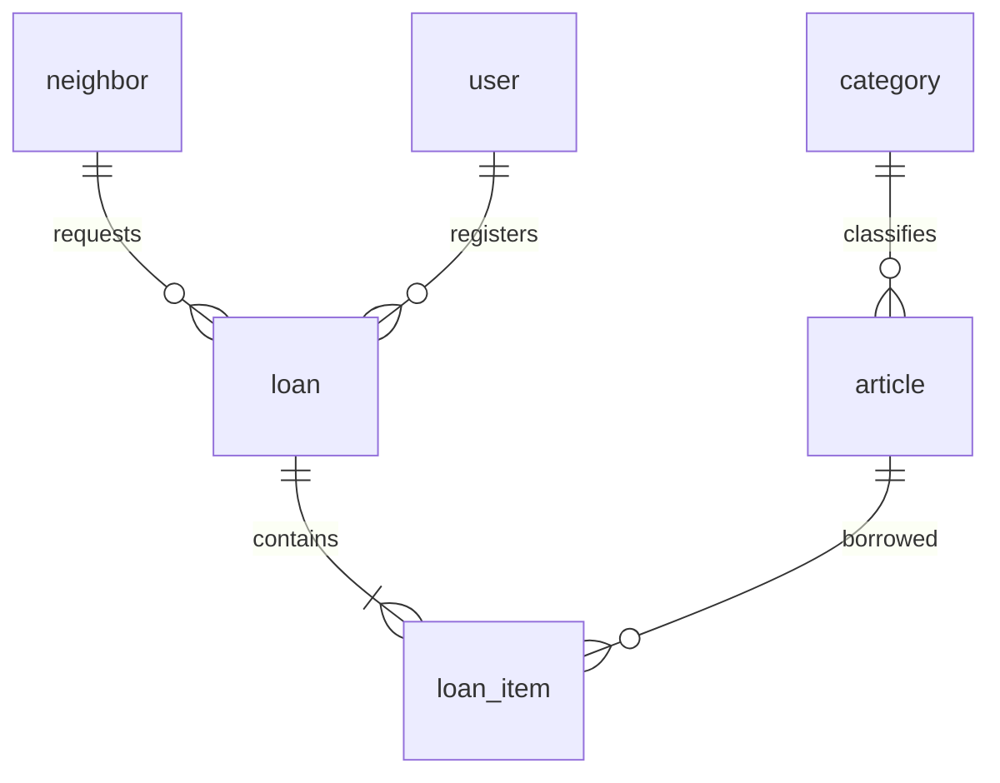

# Modelo de datos — Kitchenware

**Proyecto:** Sistema de Préstamo de Menaje de un Salón Comunal  
**Identificador:** kitchenware  
**Ficha:** ADSO 3239137  
**Aprendiz:** A16  
**Motor:** PostgreSQL 16  
**Esquema:** `kitchenware`  
**Zona horaria:** UTC

## Propósito

Definir la estructura de persistencia del sistema Kitchenware, incluyendo entidades, columnas, relaciones, restricciones, índices, privacidad y estrategias de inicialización.

Este documento es la referencia del modelo de datos y debe mantenerse coherente con `constitution.md`, `spec.md` y `architecture.md`.

Las reglas tendrán una de las siguientes clasificaciones:

- **Motor:** aplicada directamente por PostgreSQL.
- **Solo dominio:** verificada mediante las reglas de negocio de Laravel.
- **Pendiente (T-xx):** restricción que deberá implementarse en la tarea indicada de `tasks.md`.

---

## 0. Convenciones de nombres

| Elemento | Convención | Ejemplo |
|---|---|---|
| Tablas | Inglés, singular, `snake_case` | `loan_item` |
| Columnas | Inglés, `snake_case` | `returned_at` |
| Claves primarias | UUID | `id` |
| Restricciones | Prefijo `ck_` | `ck_article_available_range` |
| Esquema | `kitchenware` | `kitchenware.loan` |

La tabla `user` se referenciará como `kitchenware."user"` en SQL escrito manualmente.

## 1. Glosario

| Término | Definición | Tabla o columna |
|---|---|---|
| Artículo | Elemento de menaje disponible para préstamo | `article` |
| Categoría | Clasificación fija de artículos | `category` |
| Unidad | Cantidad física de un artículo | `article.total_units` |
| Vecino | Persona que solicita un préstamo | `neighbor` |
| Usuario | Administrador u operador autenticado | `user` |
| Préstamo | Registro de una operación de entrega | `loan` |
| Línea de préstamo | Artículo individual incluido en el préstamo | `loan_item` |
| Disponibilidad | Unidades que pueden prestarse | `article.available_units` |
| Vencimiento | Fecha límite de devolución | `loan_item.due_at` |
| Dato congelado | Valor histórico que no sigue los cambios del catálogo | `loan_item` |

Los estados `open`, `overdue` y `closed` se calcularán a partir de las fechas y devoluciones. No se almacenarán como columnas.

## 2. Entidades y relaciones

El modelo estará compuesto por seis tablas.



Relaciones:

- Una categoría puede clasificar varios artículos.
- Un vecino puede realizar varios préstamos.
- Un usuario puede registrar varios préstamos.
- Un préstamo contiene de una a tres líneas.
- Un artículo puede aparecer en diferentes préstamos a lo largo del tiempo.

No se crearán tablas independientes de multas, reservas, reportes o auditoría.

## 3. Modelo físico

Los identificadores se representarán mediante UUID.

Las fechas se guardarán usando `timestamptz` y serán generadas desde la aplicación en UTC.

Ninguna columna tendrá valores `DEFAULT` definidos en el esquema. Los valores iniciales y las reglas de creación serán responsabilidad de la aplicación.

### 3.1. Tabla `category`

Contiene las cinco categorías iniciales.

| Columna | Tipo | Nulable | Descripción |
|---|---|---|---|
| `id` | `uuid` | No | Clave primaria |
| `name` | `varchar(120)` | No | Nombre único de la categoría |

Las categorías se crean durante la migración inicial y no tendrán operaciones de mantenimiento mediante la API.

### 3.2. Tabla `article`

Representa los artículos del catálogo.

| Columna | Tipo | Nulable | Descripción |
|---|---|---|---|
| `id` | `uuid` | No | Clave primaria |
| `name` | `varchar(250)` | No | Nombre del artículo |
| `description` | `varchar(200)` | No | Descripción del artículo |
| `reference` | `varchar(50)` | No | Referencia única entre artículos activos |
| `category_id` | `uuid` | No | Clave foránea a `category` |
| `total_units` | `integer` | No | Cantidad total, mínimo 1 |
| `available_units` | `integer` | No | Cantidad disponible |
| `cover_key` | `varchar(512)` | Sí | Clave opaca de la imagen |
| `deleted_at` | `timestamptz` | Sí | Fecha de baja lógica |

La disponibilidad se calculará como la diferencia entre unidades totales y unidades prestadas pendientes de devolución.

Un artículo desactivado conservará sus registros históricos.

### 3.3. Tabla `neighbor`

Representa los vecinos registrados.

| Columna | Tipo | Nulable | Descripción |
|---|---|---|---|
| `id` | `uuid` | No | Clave primaria |
| `full_name` | `varchar(200)` | No | Nombre completo |
| `document_number` | `varchar(30)` | No | Documento único |

Los vecinos no tendrán credenciales ni acceso directo al sistema.

### 3.4. Tabla `user`

Representa los usuarios internos.

| Columna | Tipo | Nulable | Descripción |
|---|---|---|---|
| `id` | `uuid` | No | Clave primaria |
| `username` | `varchar(120)` | No | Nombre de usuario único |
| `password_hash` | `varchar(512)` | No | Contraseña protegida mediante hash |
| `role` | `varchar(40)` | No | `admin` u `operator` |

El administrador inicial será creado por la aplicación utilizando variables de entorno.

### 3.5. Tabla `loan`

Representa un préstamo registrado.

| Columna | Tipo | Nulable | Descripción |
|---|---|---|---|
| `id` | `uuid` | No | Clave primaria |
| `neighbor_id` | `uuid` | No | Clave foránea a `neighbor` |
| `loaned_by_user_id` | `uuid` | No | Clave foránea a `user` |
| `loaned_at` | `timestamptz` | No | Fecha y hora del préstamo |

Una operación de préstamo pertenece a un solo vecino.

### 3.6. Tabla `loan_item`

Representa cada artículo prestado dentro de una operación.

| Columna | Tipo | Nulable | Descripción |
|---|---|---|---|
| `id` | `uuid` | No | Clave primaria |
| `loan_id` | `uuid` | No | Clave foránea a `loan` |
| `article_id` | `uuid` | No | Clave foránea a `article` |
| `article_name` | `varchar(250)` | No | Nombre histórico del artículo |
| `article_reference` | `varchar(50)` | No | Referencia histórica |
| `category_name` | `varchar(120)` | No | Nombre histórico de categoría |
| `due_at` | `timestamptz` | No | Fecha límite de devolución |
| `returned_at` | `timestamptz` | Sí | Fecha real de devolución |

La fecha `due_at` será calculada como `loaned_at + 3 días`.

Cada línea representa exactamente una unidad prestada.

El nombre, la referencia y la categoría histórica no cambiarán cuando se modifique el catálogo.

## 4. Restricciones e índices

| Regla | Implementación | Clasificación |
|---|---|---|
| Identificadores únicos | Claves primarias UUID | Motor |
| Categoría única | `UNIQUE(category.name)` | Motor |
| Documento único | `UNIQUE(neighbor.document_number)` | Motor |
| Usuario único | `UNIQUE(user.username)` | Motor |
| Referencia única entre artículos activos | Índice único parcial con `deleted_at IS NULL` | Motor |
| Unidades disponibles entre 0 y total | `ck_article_available_range` | Motor |
| Total de unidades mayor o igual a 1 | `ck_article_total_positive` | Motor |
| Rol permitido | `ck_user_role` | Motor |
| Artículo no repetido en un préstamo | `UNIQUE(loan_id, article_id)` | Motor |
| Relaciones entre entidades | Claves foráneas | Motor |
| Máximo 3 artículos pendientes por vecino | Validación de casos de uso | Solo dominio |
| Vecino con vencidos no recibe préstamos | Validación de casos de uso | Solo dominio |
| Plazo de 3 días | Cálculo del dominio | Solo dominio |
| Préstamos de 1 a 3 líneas | Validación del dominio | Solo dominio |
| Préstamos y devoluciones no eliminables | Ausencia de operaciones de eliminación | Solo dominio |
| Préstamo y descuento en una transacción | Transacción de aplicación | Solo dominio |

Los índices de consulta incluirán:

- Artículos activos por categoría y nombre.
- Préstamos por fecha.
- Líneas por artículo.
- Líneas pendientes ordenadas por vencimiento.
- Búsqueda de usuarios por nombre.

## 5. Política de claves foráneas

| Relación | Acción al eliminar | Justificación |
|---|---|---|
| `article.category_id` | RESTRICT | Proteger las categorías referenciadas |
| `loan.neighbor_id` | RESTRICT | Conservar la identidad del solicitante |
| `loan.loaned_by_user_id` | RESTRICT | Conservar quién registró la operación |
| `loan_item.loan_id` | CASCADE | La línea depende del préstamo; no habrá operación para eliminar préstamos |
| `loan_item.article_id` | RESTRICT | Proteger la referencia histórica al artículo |

Las claves UUID no se modificarán una vez asignadas.

Se utilizará `ON UPDATE NO ACTION` para las relaciones.

## 6. Patrones de acceso

| Código | Consulta | Frecuencia |
|---|---|---|
| Q1 | Buscar artículos por nombre, descripción o categoría | Alta |
| Q2 | Consultar artículo por ID | Alta |
| Q3 | Obtener y bloquear artículos antes de prestar | Alta |
| Q4 | Listar categorías | Alta |
| Q5 | Consultar préstamo con sus líneas | Media |
| Q6 | Filtrar préstamos por fecha, estado o vecino | Alta |
| Q7 | Consultar artículos pendientes y vencidos de un vecino | Alta |
| Q8 | Consultar vencidos globales | Media |
| Q9 | Generar reporte de artículos más solicitados | Media |
| Q10 | Buscar usuario por nombre durante la autenticación | Alta |

Las consultas deberán respetar la paginación y los filtros definidos en `spec.md`.

## 7. Privacidad y retención

| Tabla | Información | Protección |
|---|---|---|
| `user` | Credenciales y roles | Acceso restringido |
| `neighbor` | Nombre y documento | Acceso exclusivo de usuarios autorizados |
| `loan` | Relación entre vecino y préstamo | Conservación histórica |
| `loan_item` | Artículos prestados y devoluciones | Conservación histórica |
| `article` | Catálogo e inventario | Baja lógica |
| `category` | Clasificación de artículos | Solo lectura |

Las contraseñas nunca se almacenarán en texto plano.

Los reportes de artículos más solicitados no incluirán información personal de vecinos ni operadores.

Los préstamos y sus líneas no se eliminarán.

Las imágenes podrán eliminarse físicamente cuando corresponda, después de actualizar correctamente su referencia en la base de datos.

## 8. Auditoría

No se añadirán columnas generales `created_at` ni `updated_at`, porque no forman parte del modelo de referencia.

Los instantes del negocio se registrarán mediante:

- `loan.loaned_at`
- `loan_item.due_at`
- `loan_item.returned_at`
- `article.deleted_at`

Las operaciones históricas permanecerán registradas mediante las relaciones entre préstamos, líneas, artículos, vecinos y usuarios.

## 9. Estrategia de semilla

Las cinco categorías se insertarán mediante la migración inicial de Laravel.

| ID | Categoría |
|---|---|
| `11111111-1111-4111-8111-111111111111` | ollas |
| `22222222-2222-4222-8222-222222222222` | vajilla |
| `33333333-3333-4333-8333-333333333333` | cubiertos |
| `44444444-4444-4444-8444-444444444444` | hornillas |
| `55555555-5555-4555-8555-555555555555` | manteles |

El administrador inicial será generado durante el arranque del backend a partir de variables de entorno.

El sembrador de demostración de `tool` utilizará exclusivamente la API HTTP para registrar artículos, vecinos y préstamos.

No utilizará conexiones SQL directas.

## 10. Verificación del modelo

El modelo se comprobará mediante consultas a PostgreSQL y pruebas automatizadas.

### 10.1. Verificar columnas

```sql
SELECT
    table_name,
    ordinal_position,
    column_name,
    data_type,
    is_nullable,
    column_default
FROM information_schema.columns
WHERE table_schema = 'kitchenware'
ORDER BY table_name, ordinal_position;
```

La consulta permitirá comprobar que las tablas y columnas correspondan a la sección 3.

### 10.2. Verificar restricciones

```sql
SELECT
    c.conrelid::regclass,
    c.conname,
    c.contype,
    pg_get_constraintdef(c.oid)
FROM pg_constraint c
JOIN pg_namespace n
    ON n.oid = c.connamespace
WHERE n.nspname = 'kitchenware'
ORDER BY 1, 3, 2;
```

### 10.3. Verificar índices

```sql
SELECT
    tablename,
    indexname,
    indexdef
FROM pg_indexes
WHERE schemaname = 'kitchenware'
ORDER BY tablename, indexname;
```

### 10.4. Verificación funcional

Se ejecutarán pruebas para confirmar que:

- Las unidades disponibles no pueden ser negativas.
- La cantidad disponible no supera el total.
- Las referencias activas no se repiten.
- Las líneas de préstamo mantienen sus valores históricos.
- Las devoluciones incrementan la disponibilidad exactamente una vez.
- Dos operaciones concurrentes no pueden prestar la misma última unidad.
- Los vencimientos se calculan utilizando instantes UTC.

Toda diferencia entre el modelo documentado y la estructura real deberá identificarse y corregirse.

El cumplimiento de este documento se demostrará mediante migraciones, pruebas automatizadas y consultas ejecutables sobre PostgreSQL 16.
